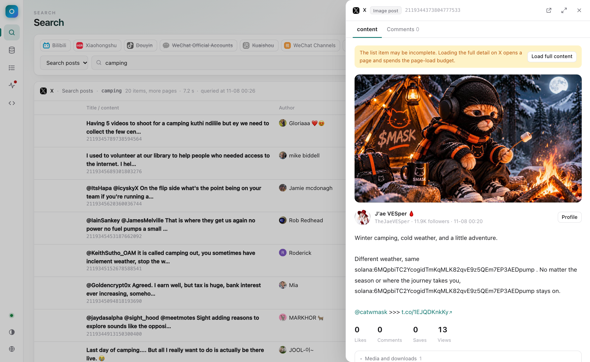
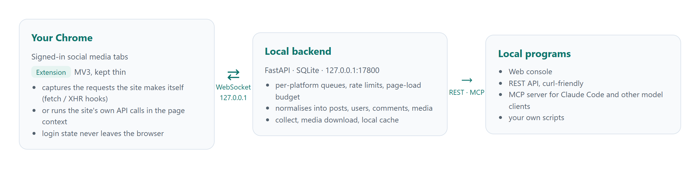
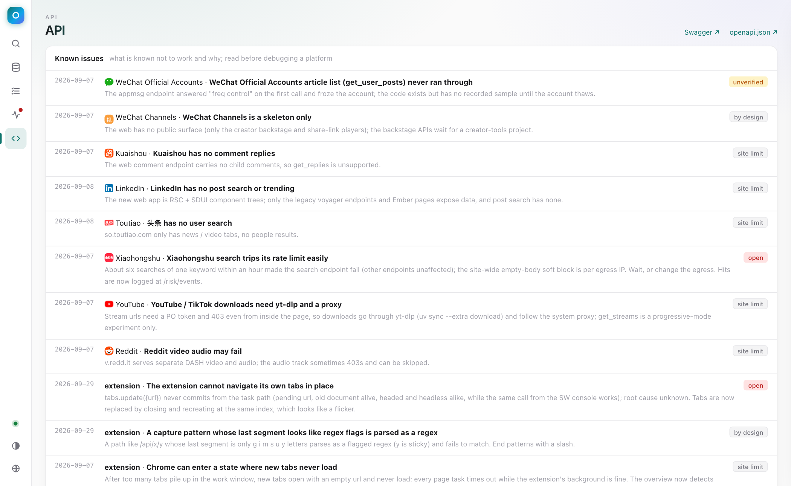

<div align="center">

            

# SocialLens

**Turn the social media accounts you are already signed in to in your browser into a local API.**

[中文](README.md) | English

      

</div>

A Chrome extension intercepts and executes each site's own requests inside your signed-in tabs and hands the data to a local FastAPI backend. The backend serves a unified REST API, an MCP server and a web console on `127.0.0.1:17800`. No platform API keys, and the backend never touches your credentials.



> For personal use only: your own accounts, the content you can already see. The project does no captcha solving, no risk-control evasion and no login automation. When a site shows a captcha, the task fails and the queue pauses until you handle it yourself.

## What it is for

**Good for** quick lookups and small-scale research:

- Search a keyword, read a post's comments, look at an account's profile and posts, from the console or by asking an AI such as Claude over MCP.
- Compare one topic across several platforms side by side.
- Follow how a handful of posts or accounts change (every query snapshots the metrics).
- Gather material for topic research, competitor analysis or content planning, in the hundreds to a few thousand items.
- Keep copies of videos and images you can already see.

**Not for**:

- Bulk collection of tens or hundreds of thousands of items, or long unattended runs. It uses your one browser and one set of accounts, spaces requests 2–6 s apart per platform, opens at most 8–40 new pages per platform every 10 minutes, and stops for you when a captcha appears.
- Servers or headless machines: the extension needs a Chrome with a window.
- Rotating accounts, proxy pools, or reaching content your own account cannot see.
- Commercial use (see [License](#license)).

## How it works



- **The extension stays thin.** It only intercepts and executes. Parsing, normalisation, storage and the public API all live in the backend.
- **Two strategies.** `call` runs the site's API inside the tab (Bilibili, Reddit and other sites whose requests are unsigned or reproducible). `navigate` opens a page and only captures what the site requests by itself (Xiaohongshu, Douyin, Instagram and other sites with non-reproducible signatures); paging scrolls or clicks in the same tab.
- **One data model.** Everything becomes `SocialPost`, `SocialUser`, `SocialComment`, `MediaItem`. Fields a platform lacks are null; the platform's own fields stay in `raw`.
- **Per-platform rate limits.** One queue per platform with a jittered interval plus a "no more than N fresh page loads per 10 minutes" budget. Over budget, tasks wait in the queue instead of failing.
- **Your tabs are left alone.** Pages the extension opens live in a separate work window, at most three per platform, reclaimed after five idle minutes. Every task runs in that window only: your own tabs, even open ones on the same platform, are never used to send requests, never navigated, scrolled or closed, so a captcha a task provokes does not land on the page you are reading. The work window stays open once created (a small note page keeps it alive), so later tasks only add tabs and never pop it up again; shrink it or move it to another screen, the position is remembered. Don't minimize it or cover it completely: some platforms page only while the page is visible.

## What each platform supports

| Platform | Search posts | Search users | Post | Comments | Replies | Profile | User posts | Feed | Trending | Download |
|---|:-:|:-:|:-:|:-:|:-:|:-:|:-:|:-:|:-:|:-:|
|  Bilibili | ✓ | ✓ | ✓ | ✓ | ✓ | ✓ | ✓ | – | ✓ | ✓ |
|  Xiaohongshu | ✓ | ✓ | ✓ | ✓ | ✓ | ✓ | ✓ | ✓ | ✓ | ✓ |
|  Douyin | ✓ | ✓ | ✓ | ✓ | ✓ | ✓ | ✓ | ✓ | ✓ | ✓ |
|  Kuaishou | ✓ | ✓ | ✓ | ✓ | – | ✓ | ✓ | ✓ | – | ✓ |
|  WeChat Official Accounts | – | ✓ | ✓ | – | – | ✓ | unverified | – | – | ✓ |
|  WeChat Channels | – | – | – | – | – | – | – | – | – | – |
|  YouTube | ✓ | ✓ | ✓ | ✓ | ✓ | ✓ | ✓ | ✓ | ✓ | ✓ |
|  X | ✓ | ✓ | ✓ | ✓ | ✓ | ✓ | ✓ | ✓ | ✓ | ✓ |
|  Reddit | ✓ | ✓ | ✓ | ✓ | ✓ | ✓ | ✓ | ✓ | ✓ | ✓ |
|  Zhihu | ✓ | ✓ | ✓ | ✓ | ✓ | ✓ | ✓ | ✓ | ✓ | ✓ |
|  TikTok | ✓ | ✓ | ✓ | ✓ | ✓ | ✓ | ✓ | ✓ | ✓ | ✓ |
|  Instagram | ✓ | ✓ | ✓ | ✓ | ✓ | ✓ | ✓ | ✓ | ✓ | ✓ |
|  LinkedIn | – | ✓ | ✓ | ✓ | ✓ | ✓ | ✓ | ✓ | – | unverified |
|  Toutiao | ✓ | – | ✓ | ✓ | ✓ | ✓ | ✓ | ✓ | ✓ | ✓ |

A check means a real-browser run with recorded samples and parser tests. A dash means the website has no entry point for it, or the old endpoint is gone. Endpoint mappings, paging mechanics and known pitfalls for every platform are in [docs/platforms/](docs/platforms/).

Platform notes:

- **WeChat Channels** only has a creator backstage and share-link players on the web, no public entry points, so only a skeleton is registered.
- **WeChat Official Accounts** search and article lists go through the Official Accounts backstage, which requires signing in to your own account at mp.weixin.qq.com (a personal subscription account is enough). The article-list endpoint is easily frozen by the backstage.
- **LinkedIn**'s new web app is server-driven UI. Feed, post detail, profile and people search call the classic voyager API inside the tab; member posts, comments and replies are captured from the classic pages that still exist. Content search and trending have no usable endpoint.
- **YouTube, Reddit, TikTok and Toutiao** work signed out for public content.
- **YouTube and TikTok** downloads go through yt-dlp (optional dependency); the backend downloads everything else directly.

## Quick start

### Option 1: no build (just uv and Chrome)

1. Install [uv](https://docs.astral.sh/uv/), then start the backend straight away (uv fetches Python 3.12 and the dependencies):

   ```bash
   uvx --from "git+https://github.com/parkour-Cat/SocialLens#subdirectory=backend" sociallens
   ```

   For YouTube / TikTok video downloads, use `--from "sociallens[download] @ git+https://github.com/parkour-Cat/SocialLens#subdirectory=backend"` instead. To pin a version, append a tag such as `@v0.1.0` to the repository URL. Data lives in `~/.sociallens/`.
2. Download the latest `sociallens-extension-*.zip` from [Releases](https://github.com/parkour-Cat/SocialLens/releases) and unzip it.
3. Continue with step 3 below, picking the unzipped folder under "Load unpacked".

### Option 2: from source

You need Python 3.12 + [uv](https://docs.astral.sh/uv/), Node 20+ + pnpm, and Chrome. Downloads also want ffmpeg on the PATH.

```bash
# 1. backend
cd backend
uv sync --extra dev            # add --extra download for yt-dlp (YouTube / TikTok downloads)
uv run sociallens              # listens on 127.0.0.1:17800

# 2. extension
cd ../extension
pnpm install
pnpm build                     # output in extension/dist; pnpm watch while developing
```

3. Open `chrome://extensions`, enable developer mode, "Load unpacked" and pick `extension/dist`.
4. The extension connects to the backend by itself. A green dot in the extension popup means it worked; nothing to configure.
5. Open http://127.0.0.1:17800/ for the console, or call the API directly:

```bash
curl http://127.0.0.1:17800/api/v1/status
curl "http://127.0.0.1:17800/api/v1/bilibili/search?keyword=camping"
```

Sign in to a platform in Chrome before querying it. `GET /api/v1/status` lists every platform's login state and login url; platforms you are not signed in to show a "Sign in" link in the popup.

The backend recognises the extension by the fixed extension id from the `key` field in `extension/manifest.json` (through the WebSocket Origin header, which page scripts cannot forge), hence zero configuration. If you change the manifest and the id changes, set `SOCIALLENS_EXTRA_EXTENSION_IDS=<new id>` or paste the content of `data/token` into the popup's advanced settings.

## Console

Open http://127.0.0.1:17800/ once the backend runs. Static files and native ES modules, no build step. Dark mode follows the system (switchable at the bottom left), the language follows the browser and can be switched at the bottom left too. The address bar keeps the page and query, so reloads, back / forward and bookmarks keep their results.

- **Search**: one command bar for platform, action and parameters, in "one page" or "up to N items" mode; cmd / ctrl + click a platform to search several at once, with results grouped per platform. Pasted post or user links are resolved. Results switch between a table and cards (image-first sites such as Xiaohongshu and Douyin default to cards); comments render as threads. Keys: `/` focus the input, `j` `k` move, `o` open, `t` table / cards.
- **Detail drawer**: laid out per content type (video, image carousel, long article, tweet card); links, @mentions and #topics in the text are clickable. Tabs for comments, the author's profile and posts, metric history, media downloads and raw JSON; expands to a full page. Platforms that can fetch the full detail without opening a page do so automatically; the ones that need a page load wait for a click, to save the page-load budget.
- **Data**: query history and the local cache (posts, users, comments), browsable by platform and exportable as JSON / CSV / Excel (pick Excel for Excel: it turns long numeric ids in a CSV into scientific notation and drops their last digits); any past query reopens in one click. The Storage tab shows how much space each kind of data takes, and prunes by the policy or clears one kind on demand.
- **Tasks**: collects, downloads and other tasks in one list, grouped as running / finished / failed, with progress and cancel; new downloads start here.
- **Status**: alerts first (paused queues with one-click resume, failing probes, extension offline), then one tile per platform with login state, page-load budget and probe result, then the risk-control log.
- **API**: the capability matrix (hover a platform icon for its notes), the REST list generated from OpenAPI with curl examples (GET endpoints can be tried in place), and the MCP tool list with the connect command.



## REST API

Every response is `{"success": true, "data": ...}` or `{"success": false, "error": {"code", "message"}}`. List endpoints return `data.items`, `data.total` and a top-level `cursor`; send the cursor back as is for the next page (a cursor is bound to a session tab and stays valid for ten minutes; a new query of the same kind on that platform takes over the tab and voids the old cursor).

| Method | Path | Purpose |
|---|---|---|
| GET | `/api/v1/status` | extension online?, per-platform login state, queues and budgets |
| GET | `/api/v1/platforms` | registered platforms and their capabilities |
| GET | `/api/v1/resolve?q=` | which platform and object a link / id points to |
| GET | `/api/v1/{platform}/search?keyword=&type=post\|user&cursor=` | search |
| GET | `/api/v1/queries?platform=&action=&q=&limit=` | query history (every list query records the ids it returned); `GET /api/v1/queries/{id}` returns those items with `metrics_then`; `GET /api/v1/items/{kind}/{platform}/{id}/history` is the item's metric snapshots (one per observed change) |
| GET | `/api/v1/known-issues?platform=` | known issues (open / unverified / site limit / by design) |
| GET | `/api/v1/risk/events?platform=&limit=` | risk-control hits (captcha / rate limit) with the page loads, tasks and callers of the previous 10 / 60 minutes; recorded only, to learn each site's real thresholds |
| GET | `/api/v1/health/platforms` | per-platform probe state (ok / broken / blocked / skipped, broken_since); `POST /api/v1/health/check` probes now; runs every 6 h by default (`SOCIALLENS_HEALTH_INTERVAL_MIN`, 0 disables) |
| GET | `/api/v1/search?keyword=&platforms=a,b,c&type=post\|user` | search several platforms at once: parallel, each under its own rate limit, results grouped per platform with their own cursor and error |
| GET | `/api/v1/{platform}/posts/{id}` | post detail |
| GET | `/api/v1/{platform}/posts/{id}/comments?cursor=` | comments |
| GET | `/api/v1/{platform}/posts/{id}/comments/{comment_id}/replies?cursor=` | replies under one comment |
| GET | `/api/v1/{platform}/users/{id}` | profile |
| GET | `/api/v1/{platform}/users/{id}/posts?cursor=` | a user's posts |
| GET | `/api/v1/{platform}/feed?cursor=` | recommendation feed / home timeline |
| GET | `/api/v1/{platform}/trending` | trending (`kind=posts` or `kind=topics`) |
| POST | `/api/v1/{platform}/collect` | collect: page in the background up to `limit` items, deduplicated |
| POST | `/api/v1/{platform}/posts/{id}/download` | download a post's media into `data/downloads/` |
| GET | `/api/v1/tasks/{id}` | task state, result, progress |
| GET | `/api/v1/tasks?platform=&status=&action=&full=` | task list; results leave out `items` and `raw` by default (their count is in `result.item_count`), `full=true` keeps them |
| POST | `/api/v1/{platform}/resume` | clear a pause caused by risk control |
| GET | `/api/v1/items?kind=&platform=` | browse the local cache |
| GET | `/api/v1/storage` | disk usage per kind of data, and the retention policy |
| POST | `/api/v1/export/xlsx` | `{"rows": [...], "name": "file name"}` to an .xlsx: strings (ids included) stay text, numbers stay numbers |
| POST | `/api/v1/storage/prune` | prune old data: no body applies the retention policy; `{"older_than_days": {"items": 90}}` picks targets and days, 0 means everything |

```bash
# collect 300 search results and wait for completion
curl -X POST http://127.0.0.1:17800/api/v1/bilibili/collect -H "content-type: application/json" \
  -d '{"action": "search_posts", "params": {"keyword": "camping"}, "limit": 300, "wait": true}'

# download one video
curl -X POST http://127.0.0.1:17800/api/v1/douyin/posts/7663480658576264457/download -H "content-type: application/json" -d '{"wait": true}'
```

Full parameters and each platform's id formats are on the console's API page and at http://127.0.0.1:17800/docs .

## MCP

`backend/sociallens/mcp/` is a thin shell over REST: stdio transport, every tool is one HTTP call to the local backend. Start the backend first, then let the MCP client launch it:

```bash
# Claude Code
claude mcp add sociallens -- uv run --project /path/to/SocialLens/backend sociallens-mcp
```

If you installed with option 1 (uvx), use `uvx --from "git+https://github.com/parkour-Cat/SocialLens#subdirectory=backend" sociallens-mcp` as the command instead.

```json
{
  "mcpServers": {
    "sociallens": {
      "command": "uv",
      "args": ["run", "--project", "/path/to/SocialLens/backend", "sociallens-mcp"],
      "env": { "SOCIALLENS_URL": "http://127.0.0.1:17800" }
    }
  }
}
```

Tools: `status`, `list_platforms`, `get_capabilities`, `search` (pass comma-separated platform ids to search several at once), `get_post`, `get_comments`, `get_replies`, `get_user`, `get_user_posts`, `get_feed`, `get_trending`, `collect`, `download`, `list_downloads`, `get_task`, `resume`, `health`, `known_issues`, `query_history`, `get_query`, `item_history`. Backend errors (`not_logged_in`, `captcha_required`, `cursor_expired`, …) are passed through as tool errors.

## Downloads and proxies

Files land in `data/downloads/{platform}/{author id}/{post id}_{index}.{ext}`. Bilibili takes the best DASH quality and merges audio and video when ffmpeg is available; Reddit's separate audio track is merged; Toutiao takes the best quality only; YouTube and TikTok go through yt-dlp.

Downloads and yt-dlp follow the system proxy by default (`HTTPS_PROXY`, otherwise the Windows / macOS proxy settings), so they use the same route as the browser. `SOCIALLENS_DOWNLOAD_PROXY=off` disables it; a proxy url overrides it.

## Data retention

The backend prunes by its retention policy every 24 hours (`SOCIALLENS_PRUNE_INTERVAL_H`, 0 disables). By default it only prunes what grows without bound and is not something you browse:

| Data | Kept by default | Environment variable |
|---|---|---|
| Finished tasks (each keeps its full result; the items are in the cache too) | 30 days | `SOCIALLENS_RETAIN_TASKS_DAYS` |
| Platform probe log | 30 days | `SOCIALLENS_RETAIN_HEALTH_DAYS` |
| Recorded captures `raw/` | 30 days | `SOCIALLENS_RETAIN_RAW_DAYS` |
| Download chunks `uploads/` | 1 day | `SOCIALLENS_RETAIN_UPLOADS_DAYS` |
| Cached posts / users / comments, query history, metric snapshots, risk-control hits | forever | `SOCIALLENS_RETAIN_{ITEMS,QUERIES,SNAPSHOTS,RISK_EVENTS}_DAYS` |

0 keeps forever. Downloaded media is never deleted automatically. `backend.log` rotates at 10 MB and keeps 3 old files (`SOCIALLENS_LOG_MAX_MB`, `SOCIALLENS_LOG_BACKUPS`).

## Boundaries

- The backend never touches platform credentials; login state lives only in the browser. The backend binds to 127.0.0.1 only.
- Web pages cannot call the local API: the Host header must be `127.0.0.1` / `localhost` / `[::1]` (blocks DNS rebinding), and under `/api/` browser requests are let through only from the console itself and the extension. Requests started by any other site (a foreign Origin, or `Sec-Fetch-Site` of cross-site / same-site) get 403. curl, MCP and scripts send neither header and are unaffected. To reach the backend under another hostname on purpose, set `SOCIALLENS_ALLOWED_HOSTS=name1,name2`.
- No captcha solving, no risk-control evasion, no login automation.
- Ordinary browsing is not recorded; the interception layer only handles traffic triggered by API tasks.
- Tasks run only in pages the extension opens in its own work window; the user's own tabs are never used for tasks, navigated or closed.

## Development

```bash
cd backend && uv run pytest                    # backend tests; a fake extension speaks the real WebSocket protocol
cd extension && pnpm typecheck
pnpm test                 # extension type check

# real-browser end to end (backend running, extension built; install Playwright's Chromium once)
cd backend && uv run python -m playwright install chromium
cd .. && uv run --project backend python scripts/e2e_chrome.py
```

Parser tests read samples from `backend/tests/fixtures/{platform}/`; a test whose sample is missing skips. Samples come in two steps:

1. `scripts/sample_*.py` record raw responses into `backend/tests/fixtures_raw/{platform}/`. Raw samples hold real users' ids, names, avatars and comments, plus your own account data when recorded logged in, so that directory is not committed.
2. `uv run --project backend python scripts/scrub_fixtures.py {platform}` writes a scrubbed copy to `fixtures/`: user ids become random numbers, names 用户N, avatars a placeholder, signatures and comment bodies placeholder text, with structure and formats unchanged. If any original name, id or avatar can still be found in the output, it refuses to write. Only platforms with rules in the script can be scrubbed; add rules for a new platform first.

`fixtures/` is committed and CI runs these tests; `test_fixture_hygiene.py` also checks committed samples for login cookies, tokens and similar credentials. `POST /api/v1/{platform}/run` with `"raw": true` returns any action's raw response.

Adding a platform: copy `docs/platforms/_template.md` and fill in the capability list; write the extension side in `platforms/{platform}/` (URL matching, login detection) and `page/platforms/{platform}.ts` (page actions returning raw JSON); write the backend adapter in `platforms/{platform}/` (capabilities, rate limit, entry URLs) and parsers (pure functions into the unified model); add the host permission to `manifest.json`. Generic page actions for exploration: `echo`, `fetch`, `wait_capture`, `scroll_capture`, `dom_probe`, `list_captures`, `find_scripts`, `read_element`, `click`, `type`.

Restart `uv run sociallens` after backend changes; rebuild with `pnpm build` and reload the extension at `chrome://extensions` after extension changes.

## Docker (backend only)

```bash
docker build -t sociallens-backend backend
docker run --rm -p 127.0.0.1:17800:17800 -v "$PWD/data:/data" sociallens-backend
```

The browser and the extension stay on the host; as long as the port is published on 127.0.0.1 the extension connects to the container by itself. The image ships ffmpeg and yt-dlp. The container cannot see the host's system proxy; pass it with `-e HTTPS_PROXY=http://host.docker.internal:7897` if needed.

## Layout

```
backend/   FastAPI backend: api/ ws/ tasks/ collect/ download/ platforms/ mcp/ models/ storage/ ui/
extension/ MV3 extension: background/ (WS client, tab routing) content/ (bridge) page/ (hooks and page actions) platforms/ popup/ work/
docs/      per-platform endpoint notes, README images
scripts/   end-to-end test and sampling scripts
data/      runtime files: token, SQLite, recorded samples, downloads, logs (not committed)
```

## License

Published under [PolyForm Noncommercial 1.0.0](LICENSE): free to use, modify and share for personal study, research and hobby projects, and for schools, charities and research institutions, but not for any commercial purpose. Contact the author for a commercial license.

Contributions are welcome; read the contribution grant in [CONTRIBUTING.md](CONTRIBUTING.md) before submitting.

## Disclaimer

**Scope of use.** This project exists for personal learning, technical research and managing your own account data. It must not be used for commercial harvesting, data resale or any other for-profit activity. If you do not intend to use it within these limits, delete it within 24 hours of downloading.

**Lawful use.** You are responsible for complying with the laws of your jurisdiction and the terms of service of each platform. Consequences of unlawful or non-compliant use are yours alone; the project and its author have no part in them.

**Use at your own risk.** The project may contain unknown defects. Automated access may also be flagged by a platform as abnormal, leading to captchas, rate limits, account restrictions or bans; the project keeps request rates deliberately low but cannot rule this out. All risk and loss concerning devices, accounts and data rests with the user.

**No warranty.** The project is provided "as is". The author does not guarantee its accuracy, completeness, timeliness or availability; platform APIs change without notice and features may stop working. The author accepts no liability for any direct or indirect loss arising from its use.

**No affiliation.** The project is not connected to, authorised by or endorsed by any platform mentioned here. Platform names and logos belong to their respective owners and appear only for identification.

**Intellectual property.** The code and documentation are protected by copyright law and the relevant international treaties, and belong to the developer. You may download, use and modify the project within the terms of the [LICENSE](LICENSE), provided you also comply with this disclaimer and applicable law.

**Acceptance.** Using the project's code or features means you have read and accept everything above and voluntarily take on the associated risks and consequences. If you do not agree, do not use it. The developer may revise this disclaimer at any time and has the final say on its interpretation.
