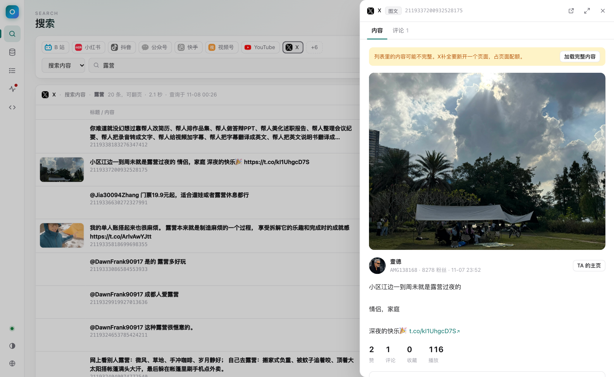
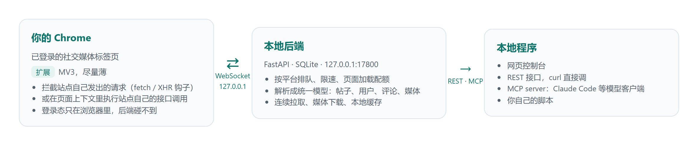
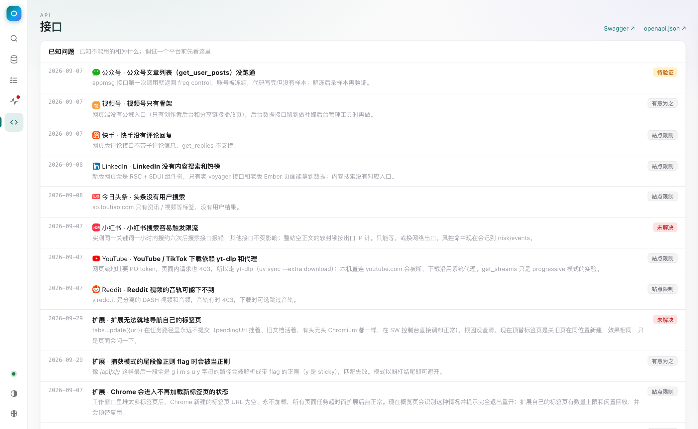

<div align="center">

            

# SocialLens

**把你浏览器里已经登录的社交媒体账号，变成一个本地 API。**

中文 | [English](README.en.md)

      

</div>

Chrome 扩展在你已登录的标签页里拦截和执行站点自己的请求，把数据交给本地 FastAPI 后端；后端在 `127.0.0.1:17800` 上提供统一的 REST 接口、MCP server 和一个网页控制台。不需要任何平台的 API key，后端也永远碰不到你的账号凭证。



> 仅供个人使用：用你自己的账号，看你自己能看到的内容。项目不做验证码识别、风控绕过和登录自动化；遇到验证码只报错并暂停队列，等你手动处理。

## 适合做什么

**适合**：随手查和小规模研究。

- 搜一个关键词、翻一条帖子的评论、看某个账号的主页和作品，在控制台里点，或者让 Claude 之类的 AI 通过 MCP 去查。
- 同一个话题在几个平台上并排看。
- 跟踪少量帖子、账号的数据变化（每次查询都会记下指标快照）。
- 给选题、竞品分析、内容研究攒素材，几百到几千条的量级。
- 把自己能看到的视频、图片下载下来留档。

**不适合**：

- 几万、几十万条的批量采集，或者长时间无人值守地跑。它只用你一个浏览器、一套账号，每个平台请求间隔 2–6 秒、10 分钟内最多新开 8–40 个页面，遇到验证码会停下来等你处理。
- 服务器或无界面环境：扩展必须跑在有界面的 Chrome 里。
- 多账号轮换、代理池，或者获取你自己账号看不到的内容。
- 商业用途（见[许可证](#许可证)）。

## 它是怎么工作的



- **扩展尽量薄**：只做拦截和执行两件事。解析、归一化、存储、对外接口全在后端。
- **两种取数策略**：`call` 是在标签页里直接调站点接口（B 站、Reddit 这类接口不签名或签名可复现的平台）；`navigate` 是打开站点页面、只捕获站点自己发出的请求（小红书、抖音、Instagram 这类接口带不可复现签名的平台），翻页靠在同一个标签页里滚动或点击。
- **统一数据模型**：所有平台都归一化成 `SocialPost`、`SocialUser`、`SocialComment`、`MediaItem`，平台没有的字段填 null，原始字段放在 `raw` 里。
- **按平台限速**：每个平台一条队列，派发间隔加抖动，另有"10 分钟内最多新开 N 个页面"的配额，超出就在队列里等，不报错。
- **不动你的标签页**：扩展自己开的页面都放在一个独立的工作窗口里，每平台最多 3 个会话页，闲置 5 分钟回收。所有任务都只在这个窗口里的页面执行：你自己打开的页面（哪怕是同一个平台、正开着的）不会被拿来发请求，也不会被跳转、滚动或关闭，任务触发的验证码不会弹在你正在看的页面上。工作窗口第一次出现后会常驻（留一个说明页），后续任务只往里加标签页、不会再弹到前面；把它缩小或挪到副屏即可，位置会记住。不要最小化或完全遮住它，有些平台靠页面可见才能滚动翻页。

## 各平台能做什么

| 平台 | 搜索内容 | 搜索用户 | 帖子详情 | 评论 | 评论回复 | 用户资料 | 用户帖子 | 推荐流 | 热榜 | 下载 |
|---|:-:|:-:|:-:|:-:|:-:|:-:|:-:|:-:|:-:|:-:|
|  B 站 | ✓ | ✓ | ✓ | ✓ | ✓ | ✓ | ✓ | – | ✓ | ✓ |
|  小红书 | ✓ | ✓ | ✓ | ✓ | ✓ | ✓ | ✓ | ✓ | ✓ | ✓ |
|  抖音 | ✓ | ✓ | ✓ | ✓ | ✓ | ✓ | ✓ | ✓ | ✓ | ✓ |
|  快手 | ✓ | ✓ | ✓ | ✓ | – | ✓ | ✓ | ✓ | – | ✓ |
|  公众号 | – | ✓ | ✓ | – | – | ✓ | 待验证 | – | – | ✓ |
|  视频号 | – | – | – | – | – | – | – | – | – | – |
|  YouTube | ✓ | ✓ | ✓ | ✓ | ✓ | ✓ | ✓ | ✓ | ✓ | ✓ |
|  X | ✓ | ✓ | ✓ | ✓ | ✓ | ✓ | ✓ | ✓ | ✓ | ✓ |
|  Reddit | ✓ | ✓ | ✓ | ✓ | ✓ | ✓ | ✓ | ✓ | ✓ | ✓ |
|  知乎 | ✓ | ✓ | ✓ | ✓ | ✓ | ✓ | ✓ | ✓ | ✓ | ✓ |
|  TikTok | ✓ | ✓ | ✓ | ✓ | ✓ | ✓ | ✓ | ✓ | ✓ | ✓ |
|  Instagram | ✓ | ✓ | ✓ | ✓ | ✓ | ✓ | ✓ | ✓ | ✓ | ✓ |
|  LinkedIn | – | ✓ | ✓ | ✓ | ✓ | ✓ | ✓ | ✓ | – | 未验证 |
|  今日头条 | ✓ | – | ✓ | ✓ | ✓ | ✓ | ✓ | ✓ | ✓ | ✓ |

打勾的都经过真实浏览器验证并有 parser 测试。空的是平台网页端没有对应入口，或老接口已下线。每个平台的接口映射、翻页方式、已知坑都记在 [docs/platforms/](docs/platforms/) 里。

几个平台的特别说明：

- **视频号** 网页端只有创作者后台和分享链接播放页，没有公域入口，只注册了骨架。
- **公众号** 的搜索和文章列表走公众号后台接口，要求你在 mp.weixin.qq.com 登录自己的公众号（个人订阅号即可）；文章列表接口容易被后台冻结。
- **LinkedIn** 新版网页是服务端驱动 UI，首页流、帖子详情、资料、人员搜索在标签页里调用老的 voyager 接口；作者动态、评论、回复靠老版页面捕获。内容搜索和热榜没有可用接口。
- **YouTube、Reddit、TikTok、今日头条** 不登录也能用公开内容。
- **YouTube、TikTok** 的视频下载交给 yt-dlp（可选依赖），其余平台后端直接下载。

## 快速开始

### 方式一：免构建（只需 uv 和 Chrome）

1. 安装 [uv](https://docs.astral.sh/uv/)，然后直接启动后端（会自动装好 Python 3.12 和依赖）：

   ```bash
   uvx --from "git+https://github.com/parkour-Cat/SocialLens#subdirectory=backend" sociallens
   ```

   要下载 YouTube / TikTok 视频，把 `--from` 换成 `"sociallens[download] @ git+https://github.com/parkour-Cat/SocialLens#subdirectory=backend"`。想固定版本，在仓库地址后加 `@v0.1.0` 这样的标签。数据存在 `~/.sociallens/`。
2. 在 [Releases](https://github.com/parkour-Cat/SocialLens/releases) 下载最新的 `sociallens-extension-*.zip` 并解压。
3. 接着做下面的第 3 步，「加载已解压的扩展程序」时选解压出来的文件夹。

### 方式二：从源码运行

需要 Python 3.12 + [uv](https://docs.astral.sh/uv/)、Node 20+ + pnpm、Chrome。下载功能另需 ffmpeg 在 PATH 上。

```bash
# 1. 后端
cd backend
uv sync --extra dev            # 加 --extra download 装 yt-dlp（YouTube / TikTok 下载）
uv run sociallens              # 监听 127.0.0.1:17800

# 2. 扩展
cd ../extension
pnpm install
pnpm build                     # 产物在 extension/dist；开发时 pnpm watch
```

3. Chrome 打开 `chrome://extensions`，开启开发者模式，「加载已解压的扩展程序」选择 `extension/dist`。
4. 扩展会自动连上后端，点扩展图标看到绿点即成功，不需要填任何配置。
5. 打开 http://127.0.0.1:17800/ 进入控制台，或者直接调接口：

```bash
curl http://127.0.0.1:17800/api/v1/status
curl "http://127.0.0.1:17800/api/v1/bilibili/search?keyword=露营"
```

在哪个平台取数，就先在 Chrome 里登录哪个平台。`GET /api/v1/status` 会列出每个平台的登录状态和登录地址，扩展 popup 里未登录的平台有"去登录"链接。

扩展是靠 `extension/manifest.json` 里的 `key` 字段固定的扩展 ID 被后端认出来的（WebSocket 的 Origin 头，网页脚本改不了），所以零配置。如果你改了 manifest 导致 ID 变化，用环境变量 `SOCIALLENS_EXTRA_EXTENSION_IDS=<新ID>` 或把 `data/token` 的内容填进 popup 的高级设置。

## 控制台

后端起来后打开 http://127.0.0.1:17800/ 。纯静态页面加原生 ES module，没有构建步骤；深色模式跟随系统（左下角可手动切换），语言跟随浏览器，左下角可切换中英文。地址栏记录当前页面和查询参数，刷新、前进后退、收藏链接都不丢结果。

- **搜索**：顶部一条命令栏，选平台、动作、参数，"一页"或"连续到 N 条"；⌘ / Ctrl + 点击平台可同时搜多个平台，结果按平台分组。输入框里直接粘帖子或用户链接也能识别。结果可在表格和卡片之间切换（小红书、抖音这类图片为主的平台默认卡片），评论按楼层展示。快捷键：`/` 聚焦输入框，`j` `k` 上下，`o` 打开详情，`t` 切换表格 / 卡片。
- **详情抽屉**：按内容类型排版（视频、图文轮播、长文、推文卡片），正文里的链接、@用户、#话题 都能点；有评论 tab、作者主页和 TA 的帖子、指标变化、媒体下载和原始 JSON，可展开成全宽详情页。不新开页面就能拿到的平台会自动补全详情，需要新开页面的平台点一下才补全，避免多占配额。
- **数据**：查询记录和本地缓存（帖子、用户、评论），可按平台浏览、导出 JSON / CSV / Excel（用 Excel 看请选 Excel：CSV 里十几位的数字 id 会被 Excel 变成科学计数法、丢掉后几位），历史查询可一键重新打开。「存储」分页显示各类数据占了多少空间，可以按保留策略清理或单独清空某一类。
- **任务**：连续拉取、下载和普通任务放在一起，按进行中 / 已完成 / 失败分组，带进度和取消；在这里新建下载。
- **状态**：风控暂停、探测失败、扩展掉线等告警在最上面，可一键恢复；每个平台一块砖，显示登录状态、页面加载配额和探测结果；下面是风控事件记录。
- **接口**：各平台能力矩阵（悬停平台图标看该平台说明）、从 OpenAPI 生成的 REST 列表（带 curl 示例，GET 可直接试）、MCP 的 tool 列表和接入命令。



## REST 接口

所有响应都是 `{"success": true, "data": ...}` 或 `{"success": false, "error": {"code", "message"}}`。列表类接口返回 `data.items`、`data.total` 和顶层 `cursor`，把 `cursor` 原样传回去取下一页（cursor 绑定一个会话标签页，十分钟内有效；同一平台再发起一次同类查询会顶掉那个页面，旧 cursor 随之失效）。

| 方法 | 路径 | 说明 |
|---|---|---|
| GET | `/api/v1/status` | 扩展是否在线、各平台登录态、队列与配额 |
| GET | `/api/v1/platforms` | 已注册平台及其能力 |
| GET | `/api/v1/resolve?q=` | 识别一条链接 / id 属于哪个平台、哪个对象 |
| GET | `/api/v1/{platform}/search?keyword=&type=post\|user&cursor=` | 搜索 |
| GET | `/api/v1/queries?platform=&action=&q=&limit=` | 查询历史（每次列表查询记下返回的条目 id）；`GET /api/v1/queries/{id}` 取当时的条目并附 `metrics_then`；`GET /api/v1/items/{kind}/{platform}/{id}/history` 是该条目的指标快照序列（指标每次变化存一份） |
| GET | `/api/v1/known-issues?platform=` | 已知问题清单（未解决 / 待验证 / 站点限制 / 有意为之） |
| GET | `/api/v1/risk/events?platform=&limit=` | 风控命中记录（验证码 / 限流）及其之前 10 / 60 分钟的页面加载、任务、调用来源；只记录不干预，用来摸各站真实阈值 |
| GET | `/api/v1/health/platforms` | 各平台探测状态（ok / broken / blocked / skipped、broken_since）；`POST /api/v1/health/check` 立即探测，默认每 6 小时自动跑一次（`SOCIALLENS_HEALTH_INTERVAL_MIN`，0 关闭） |
| GET | `/api/v1/search?keyword=&platforms=a,b,c&type=post\|user` | 多平台同时搜索：各平台并行、各自限速，结果按平台分组，每组自带 cursor 和 error |
| GET | `/api/v1/{platform}/posts/{id}` | 帖子详情 |
| GET | `/api/v1/{platform}/posts/{id}/comments?cursor=` | 评论 |
| GET | `/api/v1/{platform}/posts/{id}/comments/{comment_id}/replies?cursor=` | 评论的回复 |
| GET | `/api/v1/{platform}/posts/{id}/comments/digest?limit=200` | 拉最多 limit 条评论并生成摘要：帖子信息、统计（条数、时间范围、点赞集中度、活跃日、重复评论者）、高赞 20 条和其余评论 |
| GET | `/api/v1/{platform}/users/{id}` | 用户资料 |
| GET | `/api/v1/{platform}/users/{id}/posts?cursor=` | 用户帖子 |
| GET | `/api/v1/{platform}/feed?cursor=` | 推荐流 / 首页时间线 |
| GET | `/api/v1/{platform}/trending` | 热榜（`kind=posts` 或 `kind=topics`） |
| POST | `/api/v1/{platform}/collect` | 连续拉取：后台自动翻页到 `limit` 条，去重合并 |
| POST | `/api/v1/{platform}/posts/{id}/download` | 下载帖子的全部媒体到 `data/downloads/` |
| GET | `/api/v1/tasks/{id}` | 任务状态、结果、进度 |
| GET | `/api/v1/tasks?platform=&status=&action=&full=` | 任务列表；结果里默认不带 `items` 和 `raw`（条数在 `result.item_count`），`full=true` 才带 |
| POST | `/api/v1/{platform}/resume` | 清除风控导致的队列暂停 |
| GET | `/api/v1/items?kind=&platform=` | 浏览本地缓存 |
| GET | `/api/v1/storage` | 各类数据的占用和保留策略 |
| POST | `/api/v1/export/xlsx` | `{"rows": [...], "name": "文件名"}` 生成 .xlsx：字符串（含 id）存成文本，数字存成数字 |
| POST | `/api/v1/storage/prune` | 清理旧数据：不带参数按保留策略；`{"older_than_days": {"items": 90}}` 指定目标和天数，0 表示全部 |

```bash
# 连续拉取 300 条搜索结果并等待完成
curl -X POST http://127.0.0.1:17800/api/v1/bilibili/collect -H "content-type: application/json" \
  -d '{"action": "search_posts", "params": {"keyword": "露营"}, "limit": 300, "wait": true}'

# 下载一条视频
curl -X POST http://127.0.0.1:17800/api/v1/douyin/posts/7663480658576264457/download -H "content-type: application/json" -d '{"wait": true}'
```

完整的参数和每个平台的 id 形式见控制台的「接口」页，或 http://127.0.0.1:17800/docs 。

## MCP

`backend/sociallens/mcp/` 是 REST 的薄壳，stdio 传输，每个 tool 就是一次对本地后端的 HTTP 调用。先把后端跑起来，再让 MCP 客户端启动它：

```bash
# Claude Code
claude mcp add sociallens -- uv run --project /path/to/SocialLens/backend sociallens-mcp
```

用方式一（uvx）安装的，把命令换成 `uvx --from "git+https://github.com/parkour-Cat/SocialLens#subdirectory=backend" sociallens-mcp`。

```json
{
  "mcpServers": {
    "sociallens": {
      "command": "uv",
      "args": ["run", "--project", "/path/to/SocialLens/backend", "sociallens-mcp"],
      "env": { "SOCIALLENS_URL": "http://127.0.0.1:17800" }
    }
  }
}
```

tools：`status`、`list_platforms`、`get_capabilities`、`search`（platform 传逗号分隔的多个平台即多平台并行搜索）、`get_post`、`get_comments`、`comment_digest`（自动翻页拉一条帖子的评论，压缩成统计 + 高赞评论 + 其余评论的摘要，只留文字和点赞，适合让模型分析观众反馈）、`get_replies`、`get_user`、`get_user_posts`、`get_feed`、`get_trending`、`collect`、`download`、`health`、`known_issues`、`query_history`、`get_query`、`item_history`、`list_downloads`、`get_task`、`resume`。后端的错误（`not_logged_in`、`captcha_required`、`cursor_expired` 等）原样作为 tool error 交给模型。

prompts：`analyze_comments`（参数 platform、post_id），让模型调 `comment_digest` 后按「样本说明 → 整体评价 → 主要话题和原话 → 观众提问 → 争议 → 数据上的异常」写一份评论分析。在 Claude Code 里是 `/mcp__sociallens__analyze_comments`。

## 下载与代理

文件落在 `data/downloads/{platform}/{作者 id}/{帖子 id}_{序号}.{ext}`。B 站有 ffmpeg 时取 DASH 最高画质并合并音视频；Reddit 视频的音轨单独合并；头条视频只取最高画质；YouTube 和 TikTok 交给 yt-dlp。

后端下载和 yt-dlp 默认沿用系统代理（环境变量 `HTTPS_PROXY`，否则读 Windows / macOS 的系统代理设置），和浏览器走同一条线路。`SOCIALLENS_DOWNLOAD_PROXY=off` 关掉，或直接填一个代理地址。

## 数据保留

后端每 24 小时按保留策略清理一次（`SOCIALLENS_PRUNE_INTERVAL_H`，0 关闭）。默认只清理会无限增长、又不是你要看的东西：

| 数据 | 默认保留 | 环境变量 |
|---|---|---|
| 已结束的任务（每条带完整结果，结果里的条目已另存进缓存） | 30 天 | `SOCIALLENS_RETAIN_TASKS_DAYS` |
| 平台探测记录 | 30 天 | `SOCIALLENS_RETAIN_HEALTH_DAYS` |
| 录制样本 `raw/` | 30 天 | `SOCIALLENS_RETAIN_RAW_DAYS` |
| 下载临时分片 `uploads/` | 1 天 | `SOCIALLENS_RETAIN_UPLOADS_DAYS` |
| 缓存的帖子 / 用户 / 评论、查询记录、指标快照、风控事件 | 一直保留 | `SOCIALLENS_RETAIN_{ITEMS,QUERIES,SNAPSHOTS,RISK_EVENTS}_DAYS` |

0 表示一直保留。下载的媒体文件永远不会被自动删除。`backend.log` 满 10 MB 轮转，保留 3 个旧文件（`SOCIALLENS_LOG_MAX_MB`、`SOCIALLENS_LOG_BACKUPS`）。

## 安全边界

- 后端永远不接触平台凭证，登录态只在浏览器里；后端只绑定 127.0.0.1。
- 网页不能调用本地接口：Host 头必须是 `127.0.0.1` / `localhost` / `[::1]`（挡住 DNS 重绑定）；`/api/` 下来自浏览器的请求只放行控制台本身和扩展，其他网站发起的请求（带外站 Origin，或 `Sec-Fetch-Site` 为 cross-site / same-site）一律 403。curl、MCP、脚本不带这些头，不受影响。确实要用别的主机名访问后端时，设 `SOCIALLENS_ALLOWED_HOSTS=名字1,名字2`。
- 不做验证码识别、风控绕过、登录自动化。
- 用户平常浏览的数据默认不保存，拦截层只处理 API 任务触发的流量。
- 任务只在扩展自己开的、独立工作窗口里的页面执行；用户自己的标签页不会被用来执行任务，也不会被跳转或关闭。

## 开发

```bash
cd backend && uv run pytest                    # 后端测试，用假扩展走真实 WebSocket 协议
cd extension && pnpm typecheck
pnpm test                 # 扩展类型检查

# 真浏览器端到端（后端在跑、扩展已 build，首次要装 Playwright 的 Chromium）
cd backend && uv run python -m playwright install chromium
cd .. && uv run --project backend python scripts/e2e_chrome.py
```

parser 测试读 `backend/tests/fixtures/{platform}/` 里的样本，没有样本的测试自动跳过。样本分两步得到：

1. `scripts/sample_*.py` 录原始响应到 `backend/tests/fixtures_raw/{platform}/`。原始样本含真实用户的 id、昵称、头像、评论，登录录制时还有你自己的账号信息，这个目录不入库。
2. `uv run --project backend python scripts/scrub_fixtures.py {platform}` 生成脱敏副本到 `fixtures/`：用户 id 换成随机数、昵称换成「用户N」、头像换成占位图、签名和评论正文换成占位文字，结构和格式不变。输出里只要还能找到任何原始昵称、id 或头像，脚本就拒绝写入。只有在脚本里写了规则的平台才能脱敏，新平台要先加规则。

`fixtures/` 入库，CI 会跑这些测试；`test_fixture_hygiene.py` 另外检查入库样本里没有登录 cookie、token 之类的凭据。`POST /api/v1/{platform}/run` 带 `"raw": true` 可以拿到任何动作的原始响应。

新增一个平台：复制 `docs/platforms/_template.md` 填能力清单；在扩展的 `platforms/{platform}/`（URL 匹配、登录检测）和 `page/platforms/{platform}.ts`（页面动作，返回原始 JSON）写扩展侧；在后端 `platforms/{platform}/` 写 adapter（能力、限速、入口 URL）和 parser（纯函数，转统一模型）；在 `manifest.json` 加 host 权限。开发时可用的通用页面动作：`echo`、`fetch`、`wait_capture`、`scroll_capture`、`dom_probe`、`list_captures`、`find_scripts`、`read_element`、`click`、`type`。

改了后端要重启 `uv run sociallens`；改了扩展要重新 `pnpm build` 并在 `chrome://extensions` 里刷新。

## Docker（仅后端）

```bash
docker build -t sociallens-backend backend
docker run --rm -p 127.0.0.1:17800:17800 -v "$PWD/data:/data" sociallens-backend
```

浏览器和扩展在宿主机上；只要端口发布在 127.0.0.1 上，扩展会自动连上容器里的后端。镜像里带 ffmpeg 和 yt-dlp；容器读不到宿主机的系统代理，需要的话用 `-e HTTPS_PROXY=http://host.docker.internal:7897` 传进去。

## 目录

```
backend/   FastAPI 后端：api/ ws/ tasks/ collect/ download/ platforms/ mcp/ models/ storage/ ui/
extension/ MV3 扩展：background/（WS 客户端、标签页路由）content/（桥接）page/（拦截与页面动作）platforms/ popup/ work/
docs/      各平台接口笔记、README 用图
scripts/   端到端测试与录样本脚本
data/      运行时生成：token、SQLite、录制样本、下载、日志（不入库）
```

## 许可证

本项目按 [PolyForm Noncommercial 1.0.0](LICENSE) 发布：个人学习、研究、业余项目，以及学校、公益和研究机构可以免费使用、修改和分发，但不得用于任何商业目的。需要商业授权请联系作者。

欢迎贡献；提交前请读 [CONTRIBUTING.md](CONTRIBUTING.md) 里的贡献授权条款。

## 免责声明

**用途限制。** 本项目只用于个人学习、技术研究和管理你自己的账号数据，不得用于商业采集、数据转售或任何营利活动。如果你下载后不打算在这些范围内使用，请在 24 小时内删除。

**守法使用。** 你需要遵守所在地区的法律法规，以及各平台的用户协议。用本项目做了违法违规的事，后果由你自己承担，与本项目及作者无关。

**风险自负。** 本项目可能有未知的缺陷。自动化访问也可能被平台判定为异常，导致验证码、限流、账号受限甚至封禁；本项目虽然刻意压低了请求频率，但不能保证不会发生。设备、账号、数据方面的一切风险和损失都由使用者自行承担。

**不作保证。** 本项目按"现状"提供。作者不保证它的准确性、完整性、时效性或可用性，平台接口随时可能变化并导致功能失效。因使用本项目产生的任何直接或间接损失，作者概不负责。

**与平台无关。** 本项目和文中提到的任何平台都没有关联，未获得其授权或背书。平台名称和图标归各自所有者所有，出现在这里只是为了标识。

**知识产权。** 本项目的代码和文档受著作权法及相关国际条约保护，权利归开发者所有。你可以在 [LICENSE](LICENSE) 允许的范围内，并在遵守本声明和相关法律的前提下下载、使用和修改它。

**接受条款。** 使用本项目的代码或功能，即表示你已经读过并接受以上全部内容，并自愿承担相应的风险和后果。若不同意，请不要使用。开发者保留随时修改本声明的权利，并对本声明拥有最终解释权。
